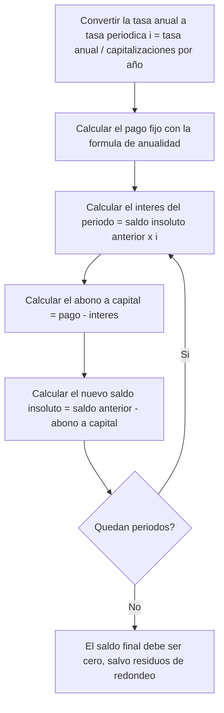
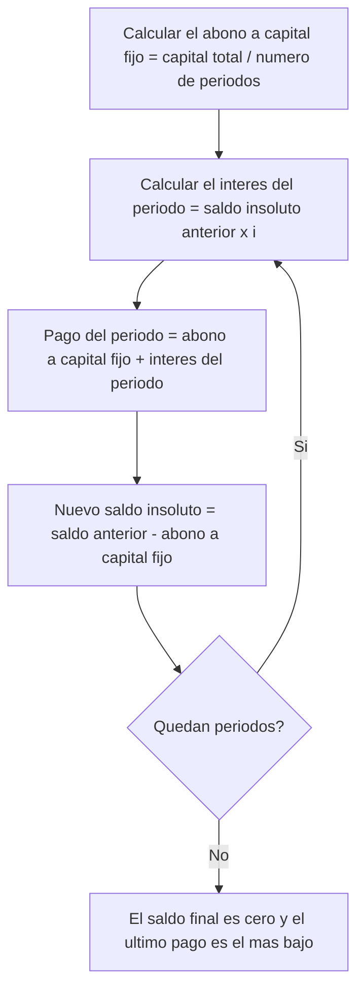
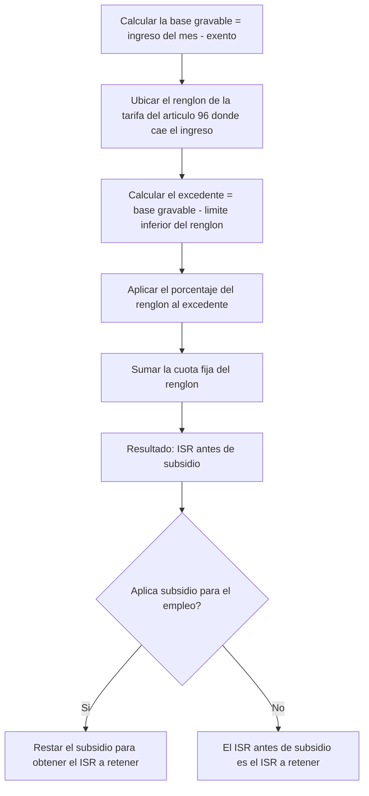

> [!example] Nota de ejemplo
> Generada por el pipeline con Claude a partir de una transcripción de prueba escrita a mano (dos partes de unos minutos, con un error del profesor a propósito). Los números del ISR son inventados.

jueves 24 de septiembre de 2026 · 2 partes · 3 min · [[Índice del diplomado]]

> [!info]- Cómo leer esta nota
> Texto normal: lo que se dijo en la sesión. *Cursiva* y bloques «Claude»: lo que agregó o corrigió Claude. (?): no se entendió en la grabación.

## Índice rápido
- [[#Sistema francés de amortización]]: pago fijo mensual que cubre interés sobre saldo insoluto y abono a capital creciente; se resuelve un ejercicio de 50,000 a 6 meses.
- [[#Sistema alemán de amortización]]: abono a capital fijo y pago decreciente; queda planteado como tarea completar la tabla comparativa.
- [[#I.S.R. de sueldos y salarios]]: cálculo mensual del ISR con la tarifa del artículo 96, ejemplo numérico con datos inventados, y mención de UMA y aguinaldo exento.

## Conceptos y definiciones
- **[[Amortización de crédito]]**: ir pagando una deuda con pagos periódicos que cubren interés y una parte del capital.
- **[[Sistema francés de amortización]]**: sistema de amortización donde el pago periódico es constante; el interés se calcula sobre el [[Saldo insoluto]] y el abono a capital crece en cada periodo. *En clase se dijo que el abono a capital también es constante en este sistema; ver corrección abajo.*
- **[[Sistema alemán de amortización]]**: sistema de amortización donde el abono a capital es constante (capital total entre número de periodos) y el pago total es decreciente, porque el interés disminuye conforme baja el saldo.
- **[[Saldo insoluto]]**: lo que todavía se debe de un crédito en un momento dado; sobre este monto se calcula el interés del periodo siguiente.
- **[[Anualidad]]**: *serie de pagos periódicos iguales usada para calcular el pago fijo de un crédito; fórmula $P = C \cdot \dfrac{i}{1-(1+i)^{-n}}$, donde $P$ es el pago, $C$ el capital, $i$ la tasa periódica y $n$ el número de periodos.*
- **[[Tasa nominal anual]]**: *tasa de interés anual que debe convertirse a la tasa del periodo de pago dividiéndola entre el número de capitalizaciones al año (por ejemplo, 24% anual capitalizable mensualmente equivale a 2% mensual).*
- **[[Impuesto Sobre la Renta]]**: impuesto que se calcula mensualmente sobre el ingreso de sueldos y salarios usando la tarifa del artículo 96 de la ley.
- **[[Base gravable]]**: el ingreso del mes menos lo exento; es la cantidad a la que se le aplica la tarifa del artículo 96.
- **[[Tarifa del artículo 96]]**: *tabla de la Ley del ISR con renglones de ingreso (límite inferior y superior), cada uno con un porcentaje a aplicar sobre el excedente y una cuota fija; sirve para calcular el ISR mensual de sueldos y salarios.*
- **[[Excedente del límite inferior]]**: la base gravable menos el límite inferior del renglón de la tarifa que corresponde al ingreso.
- **[[Cuota fija]]**: monto fijo, propio de cada renglón de la tarifa del artículo 96, que se suma al resultado de aplicar el porcentaje al excedente.
- **[[Subsidio para el empleo]]**: *cantidad que se resta del ISR calculado para ingresos bajos; a partir de cierto nivel de ingreso (como los 20,000 del ejemplo) ya no aplica.*
- **[[Unidad de Medida y Actualización]]**: *unidad de referencia usada para calcular límites de ingresos exentos, como el aguinaldo exento hasta 30 UMAs.*
- **[[Aguinaldo]]**: prestación anual que se suma al ingreso del mes en que se paga; está exenta hasta 30 UMAs y lo que exceda se grava.

## Desarrollo y práctica

### Sistema francés de amortización
Desde [P1 00:00:03]

[[Amortizar]] es ir pagando una deuda con pagos periódicos que cubren interés y una parte del capital. Hay dos sistemas: el [[Sistema francés de amortización|francés]] y el [[Sistema alemán de amortización|alemán]].

En el sistema francés el pago es constante, todos los meses se paga lo mismo. El interés de cada periodo se calcula sobre el [[Saldo insoluto]], es decir, lo que todavía se debe. La [[Tasa nominal anual|tasa]] hay que pasarla al periodo: si dan 24% anual capitalizable mensualmente, se divide entre 12 y da 2% mensual.

> [!claude] Corrección
> En clase se dijo que "en el francés el abono a capital también es constante, eso es lo que lo hace fácil". Eso es incorrecto: en el sistema francés lo constante es el **pago total**; el abono a capital crece cada periodo (porque el interés baja al bajar el saldo insoluto). El abono a capital constante es la característica del [[Sistema alemán de amortización]], no del francés.

#### Ejercicio: crédito de 50,000 a 6 meses (sistema francés)

**Datos**

| Dato | Valor |
|---|---|
| Capital | $50,000 |
| Tasa anual | 24% capitalizable mensualmente |
| Tasa mensual ($i$) | 2% |
| Plazo ($n$) | 6 meses |

**Solución en clase**

El pago se obtiene con la fórmula de [[Anualidad]]:

$$P = C \cdot \frac{i}{1-(1+i)^{-n}}$$

Sustituyendo: $P = 50{,}000 \cdot \dfrac{0.02}{1-1.02^{-6}} \approx 8{,}926$ pesos (*el valor exacto sin redondear es $8{,}926.29$; en clase se usó $8{,}926$ redondeado para el resto de la tabla*).

| Mes | Saldo inicial | Interés (2%) | Pago | Abono a capital | Saldo final |
|---|---|---|---|---|---|
| 1 | 50,000.00 | 1,000.00 | 8,926.00 | 7,926.00 | 42,074.00 |
| 2 | 42,074.00 | 841.48 | 8,926.00 | 8,084.52 | 33,989.48 |

**Pregunta de alumno:** ¿y si quiero adelantar un pago?
**Respuesta:** si se adelanta un pago se reduce el saldo, y dependiendo del banco se puede reducir el plazo o reducir el monto del pago.

> [!claude] Tabla completa (agregado)
> En clase solo se calcularon los meses 1 y 2 como ejemplo; el resto quedó de tarea. Completando con el pago redondeado de $8,926 usado en clase:
>
> | Mes | Saldo inicial | Interés (2%) | Pago | Abono a capital | Saldo final |
> |---|---|---|---|---|---|
> | 3 | 33,989.48 | 679.79 | 8,926.00 | 8,246.21 | 25,743.27 |
> | 4 | 25,743.27 | 514.87 | 8,926.00 | 8,411.13 | 17,332.14 |
> | 5 | 17,332.14 | 346.64 | 8,926.00 | 8,579.36 | 8,752.78 |
> | 6 | 8,752.78 | 175.06 | 8,926.00 | 8,750.94 | 1.84 |
>
> El saldo final no llega exactamente a cero (queda un residuo de $1.84) porque se usó el pago redondeado a $8,926 en vez del valor exacto $8,926.29. Con el pago exacto, el saldo final sería $0.

> [!claude] Procedimiento general
> Se aplica a créditos con **pago fijo periódico** (sistema francés). Pasos: 1) convertir la tasa anual a la tasa del periodo dividiendo entre el número de capitalizaciones al año; 2) calcular el pago con la fórmula de anualidad; 3) para cada periodo, calcular el interés como saldo insoluto anterior por la tasa periódica; 4) el abono a capital es el pago menos ese interés; 5) el nuevo saldo es el saldo anterior menos el abono. Errores comunes: usar la tasa anual sin convertirla al periodo, y confundir este sistema con el alemán creyendo que el abono a capital (no el pago) es lo constante.

> [!tip] Gráfica sugerida
> Graficar el saldo insoluto (eje Y) contra el número de mes (eje X) para el sistema francés, usando la tabla de arriba, para ver cómo el abono a capital crece y el saldo baja de forma no lineal.

### Sistema alemán de amortización
Desde [P1 00:00:45]

En el sistema alemán, a diferencia del francés, lo que se divide en partes iguales es el **capital**: en el ejemplo, $50,000 entre 6 meses. El pago total va bajando en cada periodo, porque el abono a capital es fijo pero el interés disminuye conforme baja el saldo insoluto.

> [!claude] Primer mes de ejemplo (agregado, ilustrativo)
> Siguiendo el mismo crédito del ejercicio anterior (50,000 a 6 meses, 2% mensual) pero con sistema alemán: abono a capital fijo = $50,000/6 = $8,333.33; interés del mes 1 = 2% de $50,000 = $1,000; pago del mes 1 = $8,333.33 + $1,000 = $9,333.33. El resto de la tabla queda como tarea (ver [[#Tareas, avisos y fechas]]).

> [!claude] Procedimiento general
> Se aplica cuando el **abono a capital** es lo fijo (sistema alemán). Pasos: 1) convertir la tasa anual a la tasa del periodo; 2) calcular el abono a capital fijo = capital total / número de periodos; 3) para cada periodo, calcular el interés sobre el saldo insoluto anterior; 4) el pago total del periodo = abono a capital fijo + interés del periodo; 5) el nuevo saldo = saldo anterior − abono a capital. Error común: aplicar la fórmula de anualidad del sistema francés cuando en realidad se pide el alemán.

### I.S.R. de sueldos y salarios
Desde [P2 00:00:03]

El [[Impuesto Sobre la Renta|I.S.R.]] mensual de sueldos y salarios se calcula con la [[Tarifa del artículo 96]] de la ley. Primero se obtiene la [[Base gravable]]: el ingreso del mes menos lo exento. Luego se busca el renglón de la tarifa que corresponde a ese ingreso. Al ingreso se le resta el límite inferior del renglón para obtener el [[Excedente del límite inferior|excedente]]; al excedente se le aplica el porcentaje del renglón, y al resultado se le suma la [[Cuota fija]] de ese renglón. Eso da el impuesto marginal más la cuota. Después se resta el [[Subsidio para el empleo]], si aplica.

#### Ejercicio: cálculo de ISR mensual (datos inventados para practicar)

*El profesor aclaró que estos números son inventados para practicar el procedimiento y no corresponden a la tarifa real vigente.*

**Datos**

| Dato | Valor |
|---|---|
| Ingreso del mes | $20,000 |
| Límite inferior del renglón | $15,000 |
| Cuota fija del renglón | $1,500 |
| Porcentaje sobre excedente | 20% |

**Solución en clase**

- Excedente = 20,000 − 15,000 = $5,000
- Impuesto marginal = 5,000 × 20% = $1,000
- ISR = 1,000 + 1,500 (cuota fija) = **$2,500**
- Subsidio para el empleo: con un ingreso de $20,000 ya no aplica.

> [!claude] Procedimiento general
> Se aplica para calcular el ISR mensual de sueldos y salarios de cualquier trabajador bajo el artículo 96 de la LISR. Pasos: 1) calcular la base gravable (ingreso del mes menos exento); 2) ubicar el renglón de la tarifa donde cae ese ingreso; 3) calcular el excedente del límite inferior; 4) aplicar el porcentaje del renglón al excedente; 5) sumar la cuota fija del renglón para obtener el ISR antes de subsidio; 6) restar el subsidio para el empleo si el nivel de ingreso lo permite. Error común: usar los límites o porcentajes de un renglón equivocado, o aplicar el subsidio en niveles de ingreso donde ya no corresponde.

### UMA y aguinaldo exento
Desde [P2 00:00:45]

La [[Unidad de Medida y Actualización|UMA]] se usa para calcular los exentos, por ejemplo el [[Aguinaldo]] está exento hasta 30 UMAs.

**Pregunta de alumno:** ¿el aguinaldo cuenta en el mes que te lo pagan?
**Respuesta:** sí, la parte gravada del aguinaldo se suma al ingreso de ese mes.

Esto se va a aplicar en el proyecto Plant Pals para la nómina de sus empleados.

## Tareas, avisos y fechas
- Para el lunes: hacer en Excel la tabla completa de amortización de los 6 meses en **ambos sistemas** (francés y alemán) del crédito de $50,000 a 24% anual capitalizable mensualmente.
- Aplicar el cálculo de ISR de sueldos y salarios en la nómina de empleados del proyecto Plant Pals.
- Examen: 8 de octubre.

## Dudas pendientes
- ¿Cuáles son los valores reales (límites, cuotas fijas y porcentajes) de la tarifa vigente del artículo 96, ya que el ejemplo usado en clase fue con números inventados para practicar?
- ¿Cuáles son las reglas exactas y los rangos de ingreso para que aplique el subsidio para el empleo?
- En el sistema francés, cuando se adelanta un pago, ¿qué determina si el banco reduce el plazo o reduce el monto del pago?
- ¿La conversión de tasa anual a tasa periódica (dividir entre el número de capitalizaciones) aplica igual para el sistema alemán, o cambia algo en ese sistema?

## Glosario
- **[[Aguinaldo]]**: prestación anual que se suma al ingreso del mes en que se paga, exenta hasta 30 UMAs.
- **[[Amortización de crédito]]**: ir pagando una deuda con pagos periódicos que cubren interés y una parte del capital.
- **[[Anualidad]]**: *serie de pagos periódicos iguales; su fórmula se usa para calcular el pago fijo de un crédito.*
- **[[Base gravable]]**: el ingreso del mes menos lo exento, base para calcular el ISR.
- **[[Cuota fija]]**: monto fijo de cada renglón de la tarifa que se suma al resultado de aplicar el porcentaje al excedente.
- **[[Excedente del límite inferior]]**: la base gravable menos el límite inferior del renglón de la tarifa correspondiente.
- **[[Impuesto Sobre la Renta]]**: impuesto calculado mensualmente sobre el ingreso de sueldos y salarios con la tarifa del artículo 96.
- **[[Saldo insoluto]]**: lo que todavía se debe de un crédito, base para calcular el interés del siguiente periodo.
- **[[Sistema alemán de amortización]]**: sistema donde el abono a capital es constante y el pago total es decreciente.
- **[[Sistema francés de amortización]]**: sistema donde el pago periódico es constante y el abono a capital crece.
- **[[Subsidio para el empleo]]**: *cantidad que se resta del ISR calculado en niveles de ingreso bajos; deja de aplicar a partir de cierto ingreso.*
- **[[Tarifa del artículo 96]]**: *tabla de la Ley del ISR con renglones de ingreso, porcentaje y cuota fija para calcular el ISR mensual de sueldos y salarios.*
- **[[Tasa nominal anual]]**: *tasa anual que debe convertirse a la tasa del periodo de pago dividiéndola entre el número de capitalizaciones al año.*
- **[[Unidad de Medida y Actualización]]**: *unidad de referencia usada para calcular límites de ingresos exentos.*

> [!quote]- Transcripción completa
> **Parte 1 de 2** · grabación iniciada a las 18:30
>
> [P1 00:00:03] Bueno, buenas tardes, vamos empezando que hoy tenemos mucho. Hoy vemos amortisación de créditos. Amortizar es ir pagando una deuda con pagos periódicos que cubren interés y una parte del capital. Hay dos sistemas que vamos a ver, el francés y el alemán. En el sistema francés el pago es constante, todos los meses pagas lo mismo. Y ojo, en el francés el abono a capital también es constante, eso es lo que lo hace fácil. El interés de cada periodo se calcula sobre el saldo insoluto, o sea lo que todavía debes. La tasa hay que pasarla al periodo. Si te dan 24 por ciento anual capitalizable mensual, divides entre 12, 2 por ciento mensual. Ejercicio. Un crédito de 50 mil pesos, 24 por ciento anual capitalizable mensualmente, 6 meses.
>
> [P1 00:00:45] El pago sale con la fórmula de anualidad, pago igual a capital por i entre uno menos uno más i a la menos n. Sustituyendo, 50 mil por 0.02 entre uno menos 1.02 a la menos 6, da 8 mil 926 pesos aproximadamente. Mes uno, interés mil pesos, el 2 por ciento de 50 mil. Abono a capital 7 mil 926. Saldo 42 mil 74. Mes dos, interés es el 2 por ciento de 42 mil 74, 841 pesos con 48. Abono 8 mil 84 con 52. Pregunta, profe, ¿y si quiero adelantar un pago? Buena pregunta, si adelantas se reduce el saldo y puedes reducir plazo o reducir el pago, depende del banco. En el alemán, en cambio, lo que se divide igual es el capital, 50 mil entre 6, y el pago va bajando. Para el lunes me hacen la tabla completa de los 6 meses en los dos sistemas en Excel.
>
> **Parte 2 de 2** · grabación iniciada a las 20:35
>
> [P2 00:00:03] Ya regresamos del descanso, seguimos con I.S.R. de sueldos y salarios. El I.S.R. mensual se calcula con la tarifa del artículo 96 de la ley. Primero la base gravable, el ingreso del mes menos lo exento. Luego buscas el renglón de la tarifa. Al ingreso le restas el límite inferior del renglón, eso es el excedente. Al excedente le aplicas el porcentaje, y le sumas la cuota fija. Eso es el impuesto marginal más la cuota. Ejemplo con números inventados para practicar, no son los de la tarifa real: ingreso de 20 mil, límite inferior 15 mil, cuota fija mil 500, porcentaje 20 por ciento. Excedente 5 mil, por 20 por ciento, mil pesos, más la cuota fija mil 500, I.S.R. de 2 mil 500. Después se resta el subsidio para el empleo si le toca. Con 20 mil ya no le toca.
>
> [P2 00:00:45] La U.M.A. la vamos a usar para los exentos, por ejemplo el aguinaldo exento hasta 30 U.M.A.s. Pregunta, ¿el aguinaldo cuenta en el mes que te lo pagan? Sí, se suma al ingreso de ese mes la parte gravada. Esto lo van a aplicar en Plant Pals para la nómina de sus empleados. El examen es el 8 de octubre.
